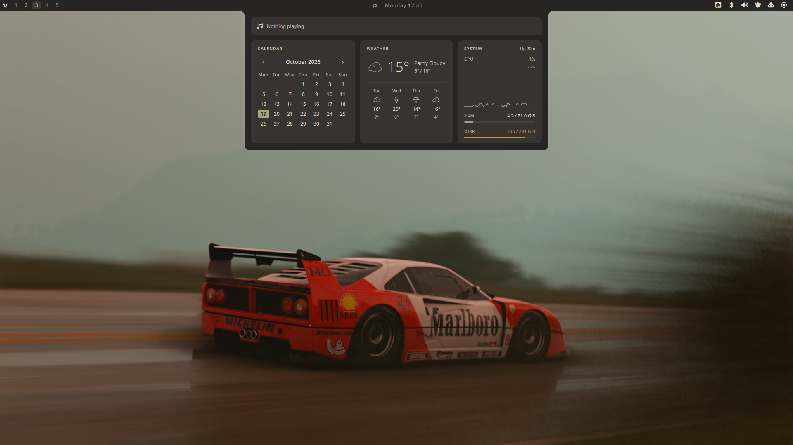

# Vellum Shell

Vellum Shell is an ink-inspired desktop shell for
[Quickshell](https://quickshell.outfoxxed.me/) and Hyprland. It provides a
multi-monitor top bar, application launcher, notification center, media
dashboard, system controls, appearance management, and a separate Wayland
session lock.

The project targets Arch Linux, CachyOS, and Fedora Linux with Hyprland 0.55 or
newer. It uses Hyprland's native Lua configuration API and assumes Kitty for
terminal helpers.

## Preview



## Features

- Per-monitor wallpaper layers and top bars with Hyprland workspaces.
- MPRIS media status, Cava visualization, clock, network, VPN, audio,
  notifications, system tray, system monitor, optional battery status, and
  power controls.
- Application launcher with desktop-entry search and frecency ranking. One
  prefix-free field searches applications, shell actions (lock, shutdown,
  appearance, screenshot) and emoji at once, and evaluates anything that looks
  like a maths expression.
- Launcher project mode (`>`) for directories under `~/Projects`.
- Terminal desktop entries (`Terminal=true`, such as Neovim or btop) open in a
  kitty window instead of being started without a TTY.
- Clipboard history with text and image previews, activation, and deletion.
- Notification server with toasts, history, actions, unread state, and DND.
- Notification center grouping per application, with collapsible groups,
  per-group unread counts, and per-group clearing.
- Media dashboard: an album-art player above a compact calendar, weather, and system statistics row.
- Google Calendar events in the calendar card and its expanded view, after a
  one-click sign-in on the Settings Calendar page (read-only access).
- PipeWire audio mixer, NetworkManager controls, volume OSD, and Polkit agent.
- Removable-device popup with mount, unmount, open, and safe power-off actions.
- Full-screen wallpaper and theme pickers in a skewed carousel, including an
  optional wallpaper-derived palette. Themes preview live on the running shell
  and are written out once you settle.
- Screenshot modes for smart selection, windows, workspaces, and regions.
- Multi-monitor Wayland lock screen with PAM authentication.
- Settings application in a real resizable window, with Hyprland display
  arrangement, tiling and decoration, input devices, a drag-and-drop top-bar
  layout editor, default applications, system diagnostics, XDG autostart
  entries, systemd user services, desktop preferences, and searchable
  keybindings. Every bar module can be reordered, moved between the left,
  center and right zones, or hidden.
- Searchable Launcher actions for guided package, AUR/COPR, web app, and terminal
  app installation and removal.

Popups are loaded on demand and coordinated so that overlapping shell surfaces
do not remain open at the same time.

## Requirements

### Core

- A Wayland session running Hyprland.
- Quickshell with Hyprland, PipeWire, MPRIS, notifications, system tray, PAM,
  Polkit, UPower, and Wayland support.
- PipeWire, NetworkManager, and udisks2.
- Rust (`cargo`) to build the backend. The shell starts without it, but with no
  theming and no system state.
- A Nerd Font for the shell icons, preferably `Symbols Nerd Font Mono`.
- Standard command-line tools such as `bash`, `hyprctl`, and `jq`. The backend
  reads NetworkManager and udisks2 over D-Bus, so `ip`, `lsblk`, `udisksctl`,
  `curl`, and `matugen` are no longer needed. Two tools are still required:
  the backend uses `nmcli` for Wi-Fi scanning and connection changes, and `jq`
  is used by the screenshot and lock-screen helper scripts.

### Feature dependencies

Some features remain usable when their optional tool is missing, while others
require the corresponding command:

| Feature | Commands |
| --- | --- |
| Launcher calculator | `qalc` |
| Media position control | `gdbus` |
| Audio control panel | `pavucontrol` |
| Audio visualization | `cava` (optional) |
| Battery status | UPower daemon (optional) |
| AI usage panel | `codex` and/or `claude` CLI with an active subscription login |
| Weather | Internet access to Open-Meteo (the backend does the request) |
| Google Calendar | A browser for sign-in and a one-time Desktop OAuth client from Google Cloud Console |
| Screenshot capture | `grim`, `slurp`, `magick`, `hyprctl`, `jq`; the selection freezes the screen with `wayfreeze` or, failing that, `hyprpicker`, and still works without either |
| Screenshot extras | `snip` (optional editor), `wl-copy`, `notify-send`, `xdg-user-dir` |
| Interactive utility scripts | `fzf`, Kitty |
| Package management | `pacman` plus `paru`/`yay` on Arch; `dnf` plus its COPR plugin on Fedora |
| Power profiles | `powerprofilesctl` or a compatible PPD D-Bus service |
| Settings default applications | `xdg-mime` from `xdg-utils` |
| Settings user services | A reachable systemd user manager |
| Bluetooth settings | `blueman-manager`, Blueberry, or KDE System Settings |
| Removable devices | `util-linux`, `udisks2`, `xdg-utils` |

The package helpers detect Arch/CachyOS or Fedora at runtime. The community
package action uses the AUR through `paru`/`yay` on Arch and enables a selected
COPR before installing on Fedora. Hyprland integration uses the native Lua API
introduced in Hyprland 0.55 (`hl.config(...)`, `hl.bind(...)`, and `hl.dsp.*`).

## Installation

Clone the repository to the path expected by the shell:

```bash
git clone https://git.asked.hu/asked/qs.git \
  "$HOME/.config/quickshell/vellum_shell"
```

Run the complete setup. It installs dependencies, creates state directories,
sets up PAM and external themes, enables required services, and installs the
Hyprland Lua modules under `~/.config/hypr/`:

```bash
cd "$HOME/.config/quickshell/vellum_shell"
./setup.sh
```

To see what it would do first — the setup checks every prerequisite up front and
prints its plan without changing anything:

```bash
./setup.sh --dry-run
```

The same preflight runs before a real install, so a missing Rust toolchain or an
unusable Hyprland config stops the setup before it has touched the system. It
also reports what it will *not* do: if you already have your own
`~/.config/hypr/bindings.lua` or `autostart.lua`, those are kept and Vellum's
versions are skipped, so the shell would come up without its key bindings. The
notice is repeated at the end of the run.

To install the Vellum login screen and make greetd the display manager as well:

```bash
./setup.sh --with-greeter
```

Use `./setup.sh --with-zen` to modify an existing Zen Browser profile and add
the generated Vellum chrome theme. It is opt-in because it changes `user.js`.

The setup preserves a valid existing wallpaper selection. If none exists, put
an image in the wallpaper directory; the shell selects the first image:

```bash
cp your-wallpaper.png "$HOME/Pictures/wallpapers/"
```

The setup installs `~/.config/hypr/autostart.lua`. It starts the shell
immediately in a running Hyprland session and automatically on later sessions.

Restart an already running instance with:

```bash
~/.config/quickshell/vellum_shell/scripts/theme-refresh
```

`install.sh` remains available as a package-only installer. `setup.sh` is the
recommended entry point for a fresh system.

Both scripts detect Arch/CachyOS and Fedora automatically. On Fedora they use
DNF and enable the `lionheartp/Hyprland` COPR recommended by Hyprland upstream.
Vellum needs Hyprland 0.55 or newer with its Lua configuration API. Fedora 44
and newer provide Quickshell directly. The installer keeps an existing
PPD-compatible power-profile service; otherwise it installs Fedora's default
`tuned-ppd`. DNF weak dependencies are disabled so the Hyprland package cannot
pull in another panel or launcher such as nwg-panel or Wofi. The package
installer passes only missing RPMs to DNF, avoiding an unrelated desktop or KDE
upgrade during setup. It targets regular DNF-based Fedora installations;
Fedora Atomic variants require their packages to be layered separately before
running `./setup.sh --skip-packages`.

### Removing it again

`scripts/uninstall` reverses what the setup installed: the systemd user service
and the `vellum` binary, the generated Hyprland modules, the `require` lines it
appended, the include/import lines it added to `kitty.conf`, `gtk.css`, and
`btop.conf`, the qt6ct palette and portal environment, and the generated Neovim
colorscheme with its LazyVim spec. It is also the ownership manifest — anything not listed there was
yours before the install and is left alone, including the repository, your
wallpapers, and your screenshots.

```bash
scripts/uninstall --dry-run     # show what would be removed
scripts/uninstall               # remove it
scripts/uninstall --with-greeter --purge-state
```

Config files you had modified yourself (your own `bindings.lua`, a `colors.lua`
that is not ours) are reported and kept.

## Usage

Bar items open their related surfaces on the selected monitor. Every major
surface is also exposed through Quickshell IPC, making it straightforward to
bind shell actions in Hyprland.

The general command format is:

```bash
quickshell ipc --path ~/.config/quickshell/vellum_shell/shell.qml call TARGET METHOD
```

### IPC reference

| Target | Methods |
| --- | --- |
| `settings` | `toggle`, `open`, `close` |
| `menu` | `toggle`, `open`, `close` (alias of `settings`) |
| `launcher` | `toggle`, `open`, `close` |
| `clipboard` | `toggle`, `open`, `close` |
| `style` | `theme`, `wallpaper`, `close` |
| `power` | `toggle`, `open`, `close` (alias of `settings`) |
| `notifications` | `toggle`, `dnd`, `close`, `clear`, `grouping`, `expand`, `collapse` |
| `audio` | `toggle`, `open`, `close` |
| `media` | `toggle`, `open`, `close`, `calendar`, `weather` (open with that card expanded), `playPause`, `next`, `previous`; `overview` and `player` are kept as aliases of `open` |
| `network` | `toggle`, `open`, `close` |
| `bluetooth` | `toggle`, `open`, `close` |
| `vpn` | `toggle`, `open`, `close`, `connect`, `disconnect`, `app` |
| `removable` | `toggle`, `open`, `close` |
| `lock` | `lock`, `suspend` (locks first and waits for compositor confirmation) |
| `about` | `toggle`, `open`, `close` (a floating kitty window running Fastfetch) |
| `screenshot` | `capture`, `window`, `workspace`, `region` |

Every overlay opens on the focused monitor and closes the others, because they
all go through `app/PopupCoordinator.qml`. `about` is the one exception: it is
not an overlay but a real window -- Hyprland floats a centred kitty running
Fastfetch -- so opening it only closes the overlays that would cover it.

The setup installs these bindings in `~/.config/hypr/bindings.lua` using the
native Hyprland Lua API:

```lua
local shell = [[quickshell ipc --path "$HOME/.config/quickshell/vellum_shell/shell.qml" call]]
hl.bind("SUPER + SPACE", hl.dsp.exec_cmd(shell .. " launcher toggle"))
hl.bind("SUPER + V", hl.dsp.exec_cmd(shell .. " clipboard toggle"))
hl.bind("SUPER + N", hl.dsp.exec_cmd(shell .. " notifications toggle"))
hl.bind("SUPER + P", hl.dsp.exec_cmd(shell .. " settings toggle"))
```

### Lock screen

The lock screen is hosted by the main shell and activated over IPC:

```bash
quickshell ipc --path ~/.config/quickshell/vellum_shell/shell.qml call lock lock
```

It creates a secure `WlSessionLock` surface on every monitor. Locking blurs the
current desktop wallpaper behind a themed scrim instead of cutting to black, so
the transition stays continuous in both directions; without a wallpaper the
shell palette and the logo watermark stand in. Every monitor sets a large serif
clock in the lower-left corner over a palette-tinted gradient; the input monitor
adds the user name and password field beneath it, the others echo the typed
characters and name the input monitor. Select the input monitor on the Settings app's System page, or
directly:

```bash
~/.config/quickshell/vellum_shell/scripts/lockscreen-monitor list
~/.config/quickshell/vellum_shell/scripts/lockscreen-monitor set HDMI-A-1
```

Authentication uses the dedicated PAM service named `vellum-shell`. The setup
installs `/etc/pam.d/vellum-shell`; no external lock-screen package is used.
When that file is missing (for example after a manual install without `sudo`),
the lock screen falls back to the system `login` service instead of refusing
every password, so a locked session can always be unlocked.

### Login screen (greetd)

The login screen is the lock screen's own QML running as a greetd greeter:
`GreeterShell.qml` → `features/lock/GreeterRoot.qml`. It reuses the lock
background, clock, password field and ambient view, and adds the greeter-only
controls: user picker, session picker (Wayland sessions from
`/usr/share/wayland-sessions`), keyboard layout, and sleep / restart / shut down.
No X server is started; there is no SDDM involved.

greetd runs a minimal Hyprland as the greeter user with
`greeter/hyprland.lua`, which starts Quickshell and exits the compositor when
the greeter quits (greetd only starts the session after the greeter is gone).
Because it is the same compositor as your desktop, connector names match and
the greeter gets the real multi-monitor layout:

- every output gets a layer-shell surface; the password field is on the
  `lockscreen-monitor` output and the others show the ambient view, which
  mirrors the typed characters;
- only the input output takes the keyboard, so typing always lands there;
- monitor modes, positions, scale, rotation and the keyboard layout are copied
  from your live session.

```bash
~/.config/quickshell/vellum_shell/scripts/greeter-install --preview   # in your session, no root; Esc quits
~/.config/quickshell/vellum_shell/scripts/greeter-install --enable    # install and make greetd the display manager
```

Run it as your user; it asks for `sudo` itself. It copies the QML to
`/usr/share/vellum-greeter/` (plus the Symbols Nerd Font, because the greeter
user cannot read `~/.local/share/fonts`), creates `/var/lib/vellum-greeter/`
(state) and `/var/cache/vellum-greeter/` (the greeter's own cache and the
remembered user/session), and with `--enable` writes `/etc/greetd/config.toml`
(the previous file is kept as `config.toml.before-vellum-*`), disables other
display managers and enables `greetd.service`. The switch takes effect at the
next boot or logout. Re-run it after changing the greeter QML.

The greeter cannot read `$HOME`, so everything it needs lives in
`/var/lib/vellum-greeter/`. The directory is root-owned and its files are
chowned to you, so the backend refreshes them without root:

| File | Written by |
| --- | --- |
| `theme.json`, `background.jpg` | the `greeter` theme generator, on every theme or wallpaper change |
| `layout.conf` | the `hypr` module, at daemon start and after every confirmed display change |
| `input-screen` | `scripts/lockscreen-monitor set` |

`layout.conf` is data, not Lua: the root-owned `greeter/hyprland.lua` parses it
line by line and drops anything that does not match the expected pattern, so a
user-writable file cannot run code in the greeter. Outputs that are unplugged
when the layout is captured keep their previous line.

PAM uses greetd's own `/etc/pam.d/greetd`. Signing in, the power actions and
the multi-monitor layout need a real greetd boot to test; the preview never
authenticates or powers anything off.

## Appearance

The Appearance Studio is a full-screen overlay below the bar with two separate
pickers that share one skewed carousel: **Wallpaper** reads images from
`$HOME/Pictures/wallpapers`, **Theme** reads palettes from `themes/`. Each
commits on its own — picking a wallpaper does not touch the theme, and picking
a theme does not touch the wallpaper. The one exception is the dynamic theme:
while it is active, a new wallpaper also re-derives the palette.

`style wallpaper` and `style theme` open the matching picker, and
double-clicking the desktop wallpaper opens the wallpaper picker on the monitor
you clicked. `Tab` switches between the two.

`←`/`→` (or `H`/`L`, or the wheel) move through the carousel and wrap at the
ends, `Home`/`End` jump to the first and last card, and `Ctrl+F` or `/` filters
wallpapers by name. Clicking a side card centres it; clicking the centred card
or pressing `Enter` applies it. `Esc` or a click on empty space closes.

Browsing wallpapers changes nothing. Browsing themes only recolours the running
shell in process, so the bar above the overlay shows the candidate palette.
`Enter` writes the choice out: a wallpaper goes to the state file and the login
screen copy, a theme to the state files plus every external application palette
(GTK, kitty, btop, Neovim, icons, Zen, login screen). Closing the theme picker
any other way restores the palette you started with.

### State files

| File | Purpose |
| --- | --- |
| `current-theme` | Active theme slug |
| `current-wallpaper` | Absolute path to the active wallpaper |
| `current-weather-location` | Location passed to Open-Meteo geocoding |
| `lockscreen-monitor` | Preferred monitor for password input |

Clipboard history lives outside the repository, in
`$XDG_STATE_HOME/vellum-shell/clipboard/` (`~/.local/state/...` by default):
`index.json` describes the entries, `blobs/` holds the copied content and
`thumbs/` the image previews. It keeps the latest 100 entries plus up to 25
pinned ones, skips anything over 5 MB, and never stores content that a password
manager marks as secret (`x-kde-passwordManagerHint`).

Weather configuration uses the following precedence:

1. `WEATHER_LOCATION`
2. `current-weather-location`
3. `Budapest`

Set `WEATHER_COORDS=latitude,longitude` to bypass location geocoding.

### Google Calendar

Settings → Calendar connects a Google account. **Sign in with Google** opens the
browser; after you approve read-only access, the events show up as dots in the
calendar card, and the expanded calendar lists the selected day's events.
Clicking an event opens it in Google Calendar. The Calendar page also chooses
which of your calendars are shown.

Google requires every desktop application to have its own OAuth client, so the
first sign-in needs a one-time setup in
[Google Cloud Console](https://console.cloud.google.com/auth/clients):

1. Create a project and enable the **Google Calendar API**.
2. In **Google Auth Platform**, fill in *Branding*, then publish the app under
   *Audience* (**In production**). In *Testing* status Google expires the
   sign-in after seven days. An unverified personal app shows a warning on the
   consent screen; continue through *Advanced*.
3. Under *Clients*, create a **Desktop app** client and paste its ID and
   secret on the Settings Calendar page.

The daemon signs in with the loopback-redirect and PKCE flow and requests only
`calendar.readonly`. The refresh token is kept in the system keyring through
the Secret Service API (GNOME Keyring or KWallet), which stores it encrypted.
Signing in fails with a clear message when no keyring is running. The plain
files hold nothing that grants access. They are created with `0600`
permissions:

| File | Contents |
| --- | --- |
| `$XDG_CONFIG_HOME/vellum-shell/google-oauth.json` | The OAuth client ID and secret, which identify the app but do not grant access to the account |
| `$XDG_STATE_HOME/vellum-shell/calendar/google.json` | The account email and which calendars are shown |

A token stored in that file by an earlier version moves to the keyring the
first time it is used. Access tokens and events are kept only in memory.
Events are synced every ten minutes while the panel or the settings page is
open, and they cover two months back and a year ahead. **Sign out** revokes
the token at Google and removes it from the keyring.

A background sync never opens a password dialog. When the keyring is locked,
the Calendar page shows **Unlock**, which asks for the keyring password once.
To avoid this after every login, give the keyring the same password as your
login. `pam_gnome_keyring` then unlocks it when you sign in.

The client can also come from `VELLUM_GOOGLE_CLIENT_ID` and
`VELLUM_GOOGLE_CLIENT_SECRET`, either in the daemon's environment or at build
time, which bakes it into the binary. The downloaded `client_secret_*.json`
file is accepted as `google-oauth.json` too.

### Themes

Each `themes/<slug>/theme.conf` defines six values:

```ini
NAME="Kanagawa Wave"
BACKGROUND="#1f1f28"
FOREGROUND="#dcd7ba"
ACCENT="#7e9cd8"
SURFACE="#2a2a37"
MUTED="#727169"
```

Included palettes are Catppuccin Mocha, Dynamic Matugen, Gruvbox Material,
Japanese Ink, Kanagawa Wave, Rose Pine, Sakura Blossom, Tokyo Night, and
Varnished Horizon.

Dynamic mode derives a Material You palette from the wallpaper inside the
backend, so no external tool is involved. A wallpaper with no usable hue keeps a
neutral palette instead of being given an invented colour.

The backend generates:

- `kitty-theme.conf` for Kitty.
- `gtk-theme.css` for GTK 3 and GTK 4.
- `~/.config/qt6ct/colors/vellum.conf` for Qt 6 applications and the Hyprland
  screen-sharing picker (through a service-specific portal environment).
- `~/.config/hypr/colors.lua` for Hyprland's native Lua configuration.
- `vellum-theme.css` in the active Zen Browser profile, imported by `userChrome.css`.
- A `btop` theme in the user's btop configuration.
- `~/.local/share/nvim/site/colors/vellum.lua`, a full Neovim colorscheme.
- A matching Vellum logo and Fastfetch configuration. A local
  `~/.config/fastfetch/config.template.jsonc` overrides the bundled layout. This
  is what the `about` target shows: `about toggle` floats a kitty window running
  Fastfetch (`scripts/fastfetch-panel`) instead of a QML panel that would have to
  re-render the same facts -- and because it is a real terminal, the kitty
  graphics logo renders too.

### Neovim and LazyVim

The Neovim colorscheme is generated into `~/.local/share/nvim/site/colors/vellum.lua`.
That directory is on Neovim's runtime path, so `:colorscheme vellum` works from
any configuration and nothing generated ends up inside the user's own nvim
config repository. The generator only runs when Neovim is present on the machine.

`nvim/vellum.lua` is the LazyVim side. `setup.sh` copies it to
`~/.config/nvim/lua/plugins/vellum.lua` when a LazyVim layout exists, leaving an
existing file of that name alone. The spec sets `colorscheme = "vellum"` and
watches the generated file, so a theme switch in the Appearance Studio recolours
running Neovim instances without a restart.

`nvim/vellum-keys/` is a small local plugin that keeps the base keymaps of the
current mode visible in a corner of the editor: file manager, new tab, delete,
save, buffer and window motions, LSP actions. Unlike which-key it needs no
leading key press — it is always on screen and follows the mode, so normal,
insert, visual and terminal each show their own list. `<leader>uk` and
`:VellumKeys on|off|toggle` hide it, and it steps aside on its own in a narrow
terminal, on the dashboard, and while a picker or the Lazy UI has focus. Its
colours are `default`-linked to the float highlights, so it follows the palette
with everything else, and the key list is data in `lua/vellum_keys/keys.lua`
(or `setup({ groups = ... })` from your own spec).

`nvim/vellum-keys.lua` is the spec that loads it from the repository, so a
`git pull` updates the hint list without copying anything into the nvim config.

The output formats live in `backend/templates/`, so they can be adjusted without
rebuilding. A missing template falls back to the version compiled into the
binary, which means theming cannot break by editing one.

These files are generated, not automatically imported by every application.
Add the relevant include or import to each application's configuration.

## Project structure

```text
vellum_shell/
├── shell.qml              Main shell entry point and composition
├── LockShell.qml          Standalone lock-screen compatibility entry point
├── GreeterShell.qml       greetd login screen entry point (installed as shell.qml)
├── app/                   Popup lifecycle, coordination, and public IPC
├── core/                  Platform and shared state controllers
├── features/              Self-contained shell features and surfaces
├── ui/                    Reusable feature-independent QML components
├── backend/               Rust backend: theme engine and state daemon
│   ├── src/modules/       One file per capability (theme, network, vpn, ...)
│   ├── templates/         Theme output templates, editable without rebuilding
│   └── tests/             Golden comparison against the previous bash output
├── nvim/                  LazyVim specs: generated colorscheme and the key hints
├── systemd/               User service that starts the backend at login
├── scripts/               Interactive helpers and installers
├── greeter/               Hyprland config for the greetd login screen
├── themes/                Declarative color palettes
└── assets/                Static visual assets
```

The intended dependency direction is:

```text
shell.qml -> app, core, features
features  -> core, ui
core      -> Quickshell, and the backend through core/Backend.qml
ui        -> QtQuick
```

## Backend

System state and theming live in a Rust daemon rather than in shell scripts and
per-tick `Process` calls. It listens on `$XDG_RUNTIME_DIR/vellum-shell.sock` and
speaks newline-delimited JSON.

The shell keeps working when the daemon is down: `core/Backend.qml` falls back to
built-in defaults and reconnects with backoff, so nothing blocks or crashes.

```bash
scripts/backend-install        # build, install, and enable the user service
vellum ping                    # which binary and git revision is running
vellum describe                # every topic and method the daemon offers
vellum theme apply rose-pine   # works with or without the daemon running
vellum watch network vpn       # live state on stdout
vellum call clipboard copy '{"id":12}'   # put a history entry back on the clipboard
```

`describe` is the contract: clients discover what exists instead of hardcoding
it, which is what the Settings app is built on.

Topics are lazy. A module's loop only runs while something is subscribed, so an
idle daemon costs no CPU and about 7 MB of memory. The one exception is
`clipboard`: history has to be recorded even while the shell is not looking, so
the daemon keeps that module running from start-up.

| Topic | Source | Replaces |
| --- | --- | --- |
| `theme` | `themes/*/theme.conf`, native Material You | 9 chained bash scripts, `matugen`, `jq` |
| `clipboard` | Wayland `wlr-data-control`, history in `$XDG_STATE_HOME/vellum-shell/clipboard` | `cliphist`, two `wl-paste --watch` loops, ImageMagick thumbnails |
| `network` | NetworkManager D-Bus for live state; bounded `nmcli` calls for Wi-Fi actions | QML-side `nmcli` and `ip -4 -j` polling |
| `vpn` | NetworkManager D-Bus, `protonvpn` for details | `protonvpn status` on every tick |
| `removable` | udisks2 D-Bus | `lsblk --json` every 2.5 s, `udisksctl` |
| `privacy` | `/proc` scan for `/dev/video*` handles | resident `camera-usage` bash loop |
| `sysstats` | `/proc`, `statvfs` | `df -P /` |
| `weather` | Open-Meteo | three `curl` calls per panel open |
| `calendar` | Google Calendar API, OAuth sign-in through the browser | — |
| `hypr` | `hyprctl`, `/sys/class/drm` EDID | hand-edited Hyprland config files |

### Hyprland settings

The Settings app never edits your own Hyprland files. What it changes is stored
in `~/.config/hypr/vellum-settings.json`, rendered into two generated modules,
and applied live with `hyprctl eval` through the native Lua API, so the change
is visible without a reload:

```text
~/.config/hypr/vellum_display.lua   hl.monitor() per configured display
~/.config/hypr/vellum_tuning.lua    hl.config() for gaps, decoration, input
```

`setup.sh` appends both to the `require` list in `hyprland.lua`, after your own
modules, so their values win. Deleting the JSON store (or the System page's
"Reset Hyprland settings") drops every override and falls back to your config.

The top-bar editor stores its independent layout in `bar-layout.json` in the
Vellum directory. It is shared by every monitor and applied live; deleting the
file restores the built-in module order on the next shell start.

Display changes go through a transaction owned by the daemon, because a bad mode
or position can leave a screen the user can no longer click on:

```text
hypr.previewMonitors   validate, apply live, arm a 12 s auto-revert; returns a token
hypr.confirmMonitors   cancel the timer and persist the layout
hypr.revertMonitors    restore the previous layout right away
```

Nothing reaches `vellum-settings.json` until it is confirmed, and the timer lives
in the daemon, so closing the Settings window — or losing the shell entirely —
still restores the previous layout. `previewMonitors` rejects a layout before it
touches the compositor: unknown outputs, unsupported resolutions, out-of-range
scale, transform or VRR values, overlapping displays, and turning off the last
active output. `setMonitors` remains for non-interactive callers and now saves
only after the live apply succeeds.

PipeWire, UPower, Bluetooth, MPRIS, notifications, the system tray, and PAM stay
in QML: Quickshell already exposes them as event-driven C++ services.

See [`layout.md`](layout.md) for the detailed architecture and migration notes.

## Development

One command runs Rust formatting, Clippy, the test suites, `qmllint`, and
ShellCheck — skipping whatever is not installed:

```bash
./scripts/check
```

The same gates run in CI (`.github/workflows/checks.yml`). To run a single piece:

```bash
cargo fmt --manifest-path backend/Cargo.toml --check
cargo clippy --manifest-path backend/Cargo.toml --all-targets -- -D warnings
cargo test --manifest-path backend/Cargo.toml
qmllint shell.qml LockShell.qml GreeterShell.qml app/*.qml core/*.qml ui/*.qml features/*/*.qml
shellcheck setup.sh install.sh scripts/*
python3 -B -m unittest discover -s tests -p 'test_*.py'
node tests/notifications.js
QT_QPA_PLATFORM=offscreen QT_QUICK_BACKEND=software \
  /usr/lib/qt6/bin/qmltestrunner -input tests/qml
```

The security regressions use isolated Unix sockets, mocked monitor metadata,
and offscreen Qt components. They do not register a notification server, run
installers, or change the active desktop. The Python tests cover shell and
Desktop Entry escaping; Node exercises the notification controller functions.
The QML tests verify that untrusted notification and clipboard text stays
literal, following [Qt's guidance for untrusted text](https://doc.qt.io/qt-6/qml-qtquick-text.html#details).

`qmllint` warns on a clean tree because it does not know the Quickshell types.
The gate rejects errors, previously unseen warning categories, and growth above
the recorded warning budget, so new diagnostics cannot disappear into that
background noise.

The shell has not yet been covered by an automated integration test in a
nested Wayland session. Test changes on a non-critical session before using the
lock screen or power actions as daily-driver controls.
