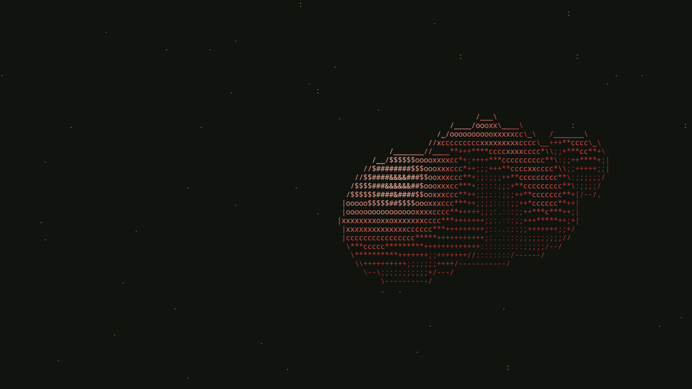
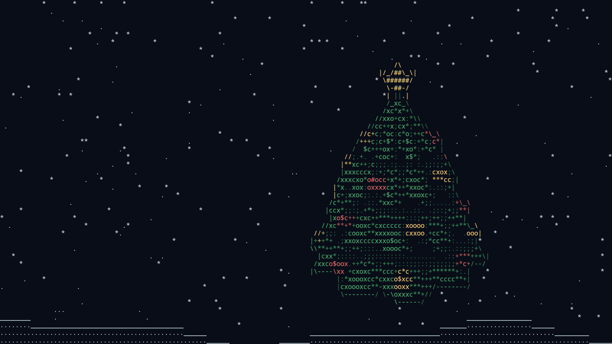
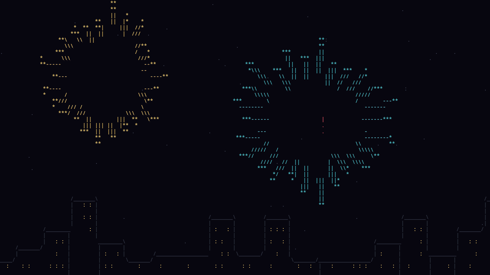
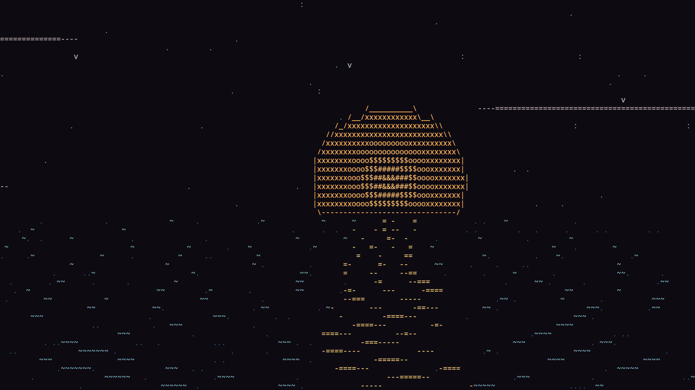
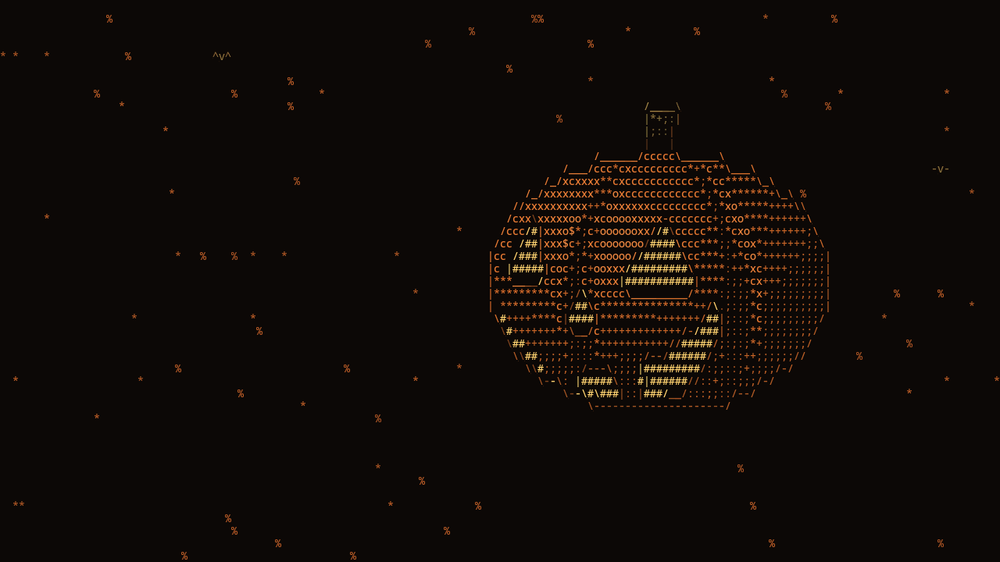
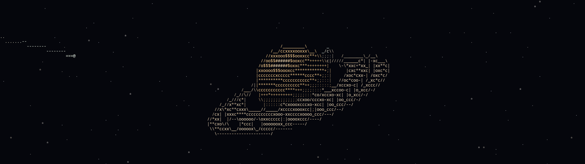

**Settings → System → Screensaver after inactivity** starts an ASCII animation on every monitor after 1 to 30 minutes without input. It is off by default.



- Any key press, click or mouse movement ends it, and that first input does not reach the application underneath.
- The mouse pointer is hidden while it runs. `scripts/screensaver-cursor` toggles Hyprland's `cursor:invisible` and restores the previous value afterwards; a small watcher started through Hyprland also restores it if the shell dies while the screensaver runs.
- It does not lock the session, and it gives way to the lock screen if that engages.
- Idle inhibitors and a focused fullscreen window keep it from starting.

Start it by hand to see a scene:

```bash
quickshell ipc --path ~/.config/quickshell/vellum_shell/shell.qml call screensaver start
```

## Scenes

**Screensaver theme**, on the same settings page, picks the scene:

| Scene | What it draws |
| --- | --- |
| Shapes (default) | A 3D form morphing between droplets, a knot, a lattice and a gem, in the active theme's colours |
| Christmas | A turning fir tree with baubles and a star, snowfall and snowdrifts |
| New Year's Eve | Fireworks over a city skyline with lit windows |
| Winter | A six-armed ice crystal in falling snow |
| Valentine's Day | A beating 3D heart with rising `<3` |
| Easter | A painted egg with zig-zag bands, falling petals and grass |
| Summer | Sunset over the sea: waves, the sun's glitter path, gulls and clouds |
| Autumn | A carved, glowing pumpkin, falling leaves and two bats |
| Orbit across monitors | One picture over all monitors: a ringed planet on the centre of the combined desktop, an orbiting moon, a comet crossing every screen and a drifting starfield |

| Christmas | New Year's Eve |
| --- | --- |
|  |  |
| **Summer** | **Autumn** |
|  |  |

Every scene except Orbit draws each monitor on its own. Orbit lays its scene over the rectangle that encloses all monitors, so the picture continues across the boundary:



The previews play about three times faster than real time.

## Automatic by season

**Automatic by season** chooses a scene when the screensaver starts. It never picks Orbit.

| Dates | Scene |
| --- | --- |
| 1 Jan – 6 Jan | New Year's Eve |
| 7 Jan – 6 Feb | Winter |
| 7 Feb – 15 Feb | Valentine's Day |
| 16 Feb – 19 Mar | Winter |
| 20 Mar – 31 May | Easter |
| 1 Jun – 31 Aug | Summer |
| 1 Sep – 30 Nov | Autumn |
| 1 Dec – 26 Dec | Christmas |
| 27 Dec – 31 Dec | New Year's Eve |

The seasonal scenes use their own colours. `features/screensaver/ScreensaverThemes.js` holds their palettes and this calendar.

## How it is drawn

The screensaver needs no terminal and no idle daemon: `features/screensaver/` is a Quickshell overlay rendered by two fragment shaders, so it costs nothing until it starts.

Each scene is one `shaders/<theme>.frag`, which includes the shared `shaders/common.glsl`. The compiled `.qsb` files are checked in. After editing a `.frag` or `common.glsl`:

```bash
scripts/build-shaders     # needs the Qt 6 Shader Tools
scripts/theme-refresh     # restart the shell
```

A live reload keeps using the shaders Qt has already cached in the running process, so the restart is needed.
